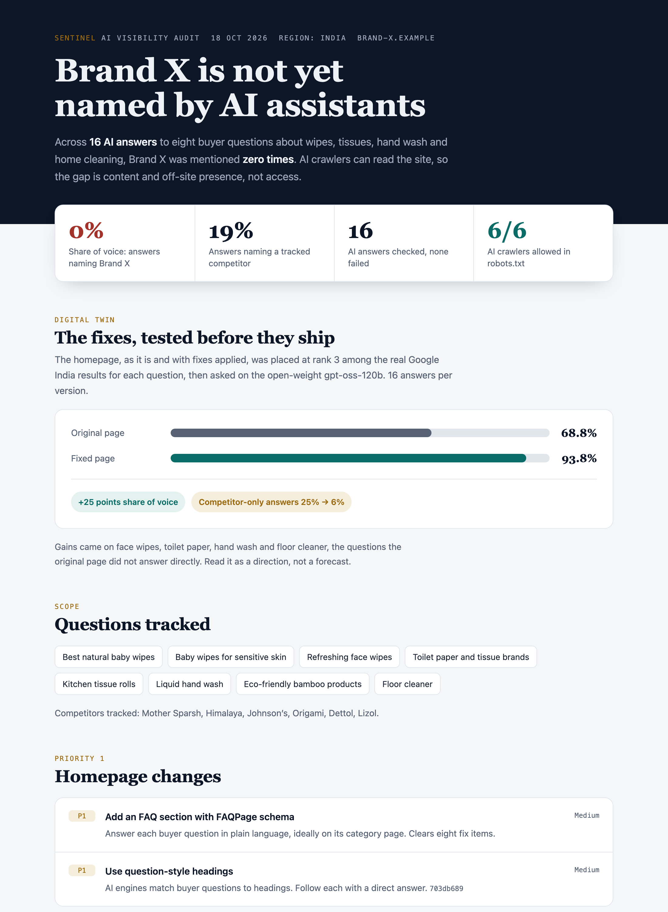

# Sentinel AI: Phase 1 engine

Weekly AI-citation tracker per BRD v1.1. Python 3.10+, only dependency: `requests`.

## Run
```
pip install requests
python tests/test_engine.py                                   # 8 tests, no keys needed
python -m sentinel.run clients/acme.json --mock               # full cycle with fake engines
export OPENAI_API_KEY=... ANTHROPIC_API_KEY=... GEMINI_API_KEY=... PERPLEXITY_API_KEY=...
python -m sentinel.run clients/acme.json --samples 3          # real engines
```
Output per client in `data/<domain>/`: `latest_report.md`, `history.json`, `audit.jsonl`, `review_queue.json`.

## Optimization (needs internet; add `--optimize`)
```
python -m sentinel.run clients/acme.json --samples 3 --optimize
```
Adds to the report and writes `data/<domain>/fixes.json`:
1. **Crawler access** (`crawlers.py`): reads robots.txt; flags blocked OAI-SearchBot, ClaudeBot, PerplexityBot, etc. as **P0**.
2. **Page gap analysis** (`pagegap.py`): for each losing prompt (SoV under 50%), fetches your page and the competitor pages engines cited, and lists what they have that you lack (direct answer, FAQ schema, Organization schema, table, question headings, depth). **P1**.
3. **Fix list** (`fixes.py`): P0 crawler fixes, P1 page changes, P2 third-party sites engines cite that you are not on (earned by a person).
Optional client config: `"default_page"` and `"target_pages": {"<prompt>": "<url>"}` to point at the right page per prompt.
Everything is a recommendation for the client to approve; nothing is published.

### SEO, AEO and analytics (all free data)
```
python -m sentinel.run clients/acme.json --seo                      # technical SEO + AEO audit of key pages
python -m sentinel.run clients/acme.json --ga4 ga4_export.csv       # AI-referral traffic report
python -m sentinel.run clients/acme.json --gsc google_queries.csv --gsc bing_queries.csv   # ranking opportunities + new prompts
python -m sentinel.run clients/acme.json --backlinks ahrefs_links.csv --backlinks bing_links.csv  # backlink profile
```
- `--seo` (`seo.py`, `aeo.py`): per key page: noindex, status, HTTPS, redirects, canonical, title/meta length, H1, heading order, alt text, viewport, language, internal links, sitemap + robots sitemap line; AEO: question headings, answer length (30-70 words), FAQPage/HowTo schema, snippet-ready opening. Pages come from `pages_to_audit` (list) or `default_page` + `target_pages` in the client config. Issues merge into the same P0/P1/P2 fix list with ids.
- `--ga4`: GA4 "Traffic acquisition" CSV. Counts sessions from ChatGPT, Perplexity, Gemini, Copilot, Claude etc. Some AI tools send no referrer, so this undercounts.
- `--gsc`: Search Console "Queries" CSV. Lists striking-distance queries (position 5-20), page-one queries with low CTR, and real questions to add as tracked prompts.
- `--backlinks` (`backlinks.py`): inbound-links CSV from **Ahrefs Webmaster Tools** or **Bing Webmaster Tools** (both free for sites the client owns; pass both by repeating the flag, duplicates are removed). Reports links, referring domains, anchor mix (brand / naked URL / generic / keyword), nofollow share, thin or one-source-dominated profiles, and **sites AI engines cite for your prompts that do not link to you** (outreach targets). Only the client's own links are available free; there is no free competitor backlink data.
- `--gsc` can be repeated: pass a Google Search Console Queries export and a Bing Webmaster Queries export together; they are merged (impressions summed, position weighted by impressions).
- Live GA4 / Search Console API links need OAuth credentials (not built yet); the CSV exports work today.

### Content quality, coverage and results
- `--llm-review` (with `--optimize`, needs `ANTHROPIC_API_KEY`): one model call per losing prompt scores your page vs the cited pages on how directly it answers the question. Suggestions may only use facts on your page; missing facts appear as `[client to supply: ...]`. Roughly one extra call per losing prompt.
- Cited competitor pages that cannot be fetched are listed in the fix list ("compare by hand") and every comparison says how many pages it covered. Nothing is skipped silently.
- Every fix has an id. When the client applies one: `python -m sentinel.run clients/acme.json --mark-applied <id> --applied-on 2026-10-20`.
  Later reports add "Results of applied fixes": the prompt's average SoV over up to 4 weeks before vs cycles from 7 days after. A change counts only if it exceeds 10 points and 2x the normal week-to-week noise. Fixes with no prompt (such as crawler access) use overall SoV. It shows association, not proof.

## What each part does (BRD mapping)
| File | BRD | Behavior |
| --- | --- | --- |
| `providers.py` | 4.2 | 4 engines + mock; 30 s timeout, one retry; models set by env vars |
| `parser.py` | 4.3.1 | Brand/domain detection, URL extraction, tone flag |
| `metrics.py` | 4.3.2 | SoV (+ spread across samples), competitor overlap, source map, tone |
| `audit.py` | 6.2 | Hash-chained log, one entry per check; `verify()` detects tampering |
| `remediation.py` | 4.4 | Drop detection (20 pts below 4-cycle average, 2 cycles) and BLUF drafts into a review queue |
| `run.py` | 4.2 | Parallel cycle, history, report |

## Known limits (be honest with clients)
- Remediation only **drafts**; there is no publish step. Add one only after approval workflow exists.
- Drop detection needs 5 weekly cycles of history before it can flag anything.
- Sentiment is a keyword heuristic; treat as a rough flag.
- Real-provider endpoints and model names are defaults; verify against current vendor docs and terms. Real-provider code was not run (no API keys here).
- Schedule weekly with cron or GitHub Actions: `python -m sentinel.run clients/<client>.json`.
- Keep API keys in environment variables or a secrets manager; never commit them.

## Free engines and the digital twin
- Free engines: `gemini`, `groq` (`GROQ_API_KEY`, default `openai/gpt-oss-120b`) and `openrouter` (`OPENROUTER_API_KEY`, default `openrouter/free`). Override models with `GROQ_MODEL` / `OPENROUTER_MODEL`. See `clients/acme_free.json`.
- Digital twin: `python -m sentinel.twin clients/acme.json --engine groq`. Puts the client's `default_page` (as it is, and with `clients/<name>_twin_fixes.json` applied) among the real Google results for each prompt (SerpApi, `SERPAPI_API_KEY`, cached per prompt), asks the same prompts against both, and writes share of voice and competitor-only answers to `data/<domain>/twin.json`. Use `TWIN_PACE` (seconds) for free-tier rate limits. Fixes should only use facts the brand can stand behind.


